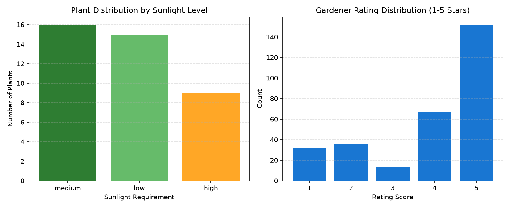
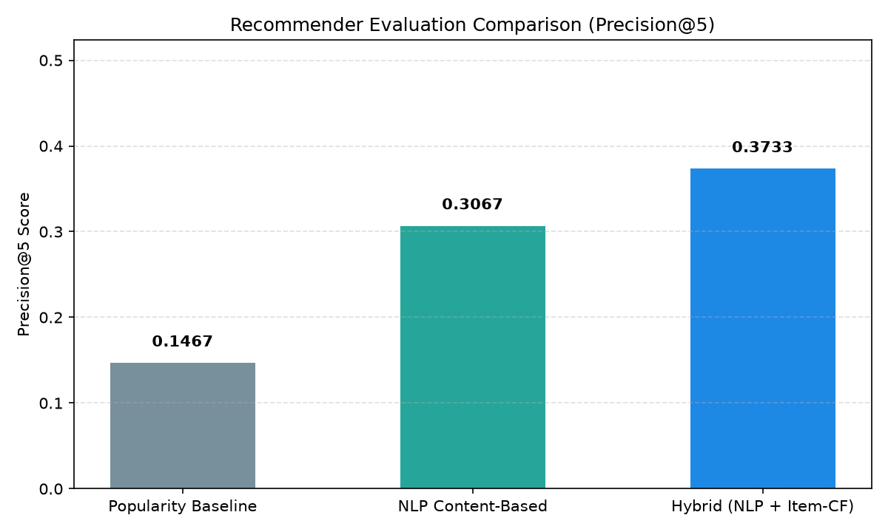

# Indoor Plant and Home Gardening Recommender (MP-C07)

## (a) Student & Project Information
- **Student Name:** Phạm Ngô Văn Khiêm
- **Student ID:** 29211355729
- **Course / Section:** CS467 Advanced Artificial Intelligence — Section CS467C (No. 07)
- **Instructor:** Puri Vikram
- **Project Code & Title:** MP-C07 — Indoor Plant and Home Gardening Recommender
- **GitHub Repository:** [https://github.com/PhamKhiem2k5/cs467-miniproject-29211355729](https://github.com/PhamKhiem2k5/cs467-miniproject-29211355729)

---

## (b) Problem Statement
Beginner indoor gardeners frequently choose houseplants that do not match their room's sunlight availability or their personal watering routine, leading to plant stress or failure. This mini-project builds an end-to-end Python recommendation application that combines **Natural Language Processing (NLP)** on plant care guides and feature tags with **Collaborative Filtering (CF)** over gardener ratings to provide accurate, personalized, and keyword-explainable plant recommendations.

---

## (c) Dataset Description
The custom domain dataset is stored in CSV format inside `data/`:
- **`data/items.csv`**: Contains **40 indoor plant species** (`P01`–`P40`) with 6 attributes: `item_id`, `plant_name`, `sunlight_level` (`low`, `medium`, `high`), `care_difficulty` (`beginner`, `intermediate`, `advanced`), `care_guide_text`, and semicolon-delimited `feature_tags`.
- **`data/ratings.csv`**: Contains **300 user-item interactions** across **15 gardeners** (`U01`–`U15`), where each user rated 20 plants on a 1–5 star scale along with practical `grower_tip` notes.
- **Sparsity Analysis**: Out of $15 \times 40 = 600$ possible user-item pairs, 300 are observed, resulting in a realistic matrix sparsity of **50.0%** (within the target 40%–65% range).

---

## (d) NLP and Recommendation Methods
1. **NLP Pipeline (`src/nlp_pipeline.py`):**
   - **Text Preprocessing:** Lowercases text, strips punctuation and extra whitespace via regex, tokenizes into words, and removes English stop-words while preserving essential domain modifiers (such as `low`, `no`, `not`).
   - **Feature Extraction:** Computes unigram and bigram **TF-IDF** vectors (`ngram_range=(1, 2)`, `max_features=500`) across combined plant names, care guides, and tags.
   - **Keyword Explanation:** Extracts matching gardening care-condition keywords (e.g., `low light`, `easy watering`, `desk plant`, `beginner`, `pet safe`) for every recommendation.
2. **Popularity Baseline (`src/recommender.py`):**
   - Ranks unrated plants by average gardener rating subject to a minimum rating count threshold (`min_ratings=3`).
3. **NLP Content-Based Recommender (`src/recommender.py`):**
   - Computes **Cosine Similarity** over TF-IDF vectors to support: (a) free-text room-condition queries, (b) item-to-item similar plant retrieval, and (c) weighted user-profile recommendations.
4. **Hybrid Extension — NLP + Item-Based CF (`src/recommender.py`):**
   - Computes mean-centered **Item-Based Collaborative Filtering** rating predictions $\hat{r}_{u,i}$ from peer ratings, normalizes them to $[0, 1]$, and blends them with normalized NLP content similarity scores ($\alpha = 0.5$):
     $$\text{Score}_{\text{Hybrid}}(u, i) = \alpha \cdot \text{Sim}_{\text{NLP}}(u, i) + (1 - \alpha) \cdot \hat{r}_{\text{CF, norm}}(u, i)$$

---

## (e) Installation and Run Commands
```bash
# 1. Clone the public repository
git clone https://github.com/PhamKhiem2k5/cs467-miniproject-29211355729.git
cd cs467-miniproject-29211355729

# 2. Install required dependencies
pip install -r requirements.txt

# 3. Run the full demo, generate evaluation charts, and enter interactive mode
python src/main.py

# Optional: Run in non-interactive batch mode (saves outputs directly to results/)
python src/main.py --no-interactive

# Optional: Run standalone evaluation and chart generation
python src/evaluate.py
```

---

## (f) Sample Outputs (3 Required Test Cases)
Full saved outputs are also available in `results/sample_outputs.txt`.

### Test Case 1: Room-Condition Free-Text Query
**Query:** `'low light apartment desk plant easy watering for beginners'`
```text
item_id             plant_name  score                               matched_keywords sunlight_level care_difficulty
    P11           Lucky Bamboo 0.5094 low light, beginner, easy watering, desk plant            low        beginner
    P07      Chinese Evergreen 0.5051 low light, beginner, easy watering, desk plant            low        beginner
    P01            Snake Plant 0.4805 low light, beginner, easy watering, desk plant            low        beginner
    P09 Heartleaf Philodendron 0.4444 low light, beginner, easy watering, desk plant            low        beginner
    P25  Peperomia Obtusifolia 0.4090 low light, beginner, easy watering, desk plant            low        beginner
```

### Test Case 2: Similar-Plant Test (Item-to-Item)
**Target Gardener:** `U01` | **Highest-Rated Plant:** `P01` (*Snake Plant*, Rating: `5/5`)
```text
item_id           plant_name  score                               matched_keywords sunlight_level care_difficulty
    P19  Echeveria Succulent 0.3123     beginner, easy watering, desk plant, every           high        beginner
    P29   Money Tree Pachira 0.3113 low light, beginner, easy watering, desk plant         medium        beginner
    P26 Fittonia Nerve Plant 0.3020          low light, desk plant, needs, thrives            low    intermediate
    P20      Haworthia Zebra 0.2926 beginner, easy watering, desk plant, apartment         medium        beginner
    P08          Parlor Palm 0.2858  low light, beginner, apartment, air purifying            low        beginner
```

### Test Case 3: Cold-Start Test (New Nursery Plant `P41` with Care Text Only)
**Added Plant:** `P41` — *Mini Velvet Fern (New Nursery Arrival)* (0 ratings, text description only)  
**Query:** `'low light apartment desk plant easy watering for beginners'`
```text
item_id                             plant_name  score                               matched_keywords sunlight_level care_difficulty
    P41 Mini Velvet Fern (New Nursery Arrival) 0.6200 low light, beginner, easy watering, desk plant            low        beginner
    P07                      Chinese Evergreen 0.4396 low light, beginner, easy watering, desk plant            low        beginner
    P11                           Lucky Bamboo 0.4382 low light, beginner, easy watering, desk plant            low        beginner
    P01                            Snake Plant 0.4263 low light, beginner, easy watering, desk plant            low        beginner
    P09                 Heartleaf Philodendron 0.3956 low light, beginner, easy watering, desk plant            low        beginner
```

---

## (g) Evaluation Results Table and Charts
Offline evaluation was conducted using an **80/20 per-user train/test split** (`seed=42`), defining relevant test items as plants rated $\ge 4$ stars:

| Recommendation Method | Precision@5 | Rating Prediction Error |
| :--- | :---: | :---: |
| **Popularity Baseline** | `0.1467` | — |
| **NLP Content-Based** | `0.3067` | — |
| **Hybrid Extension (NLP + Item-CF)** | **`0.3733`** | RMSE: `0.9268` \| MAE: `0.6658` |

### Generated Visualizations (`results/`)




---

## (h) Short Reflection
- **What Worked Well:**
  - Incorporating bigrams (`ngram_range=(1, 2)`) and preserving negative/low-intensity modifiers (`low`) in `src/nlp_pipeline.py` allowed TF-IDF to capture domain-specific care phrases such as `low light`, `easy watering`, and `desk plant`.
  - The system handled cold-start items seamlessly: newly added nursery plant `P41` (with zero ratings) was immediately retrieved at Rank #1 (`score = 0.6200`) for matching room conditions.
  - Combining Item-Based Collaborative Filtering with NLP content similarity improved **Precision@5** from `0.1467` (Popularity Baseline) and `0.3067` (NLP-only) to **`0.3733`**.
- **Limitations & Future Improvements:**
  - **Lexical Matching:** TF-IDF relies on exact token overlap and cannot recognize synonyms (e.g., *"dim room"* vs. *"low light"*). Integrating pre-trained dense sentence embeddings (such as Sentence-BERT) would improve semantic recall.
  - **Dataset Scale:** Expanding beyond 15 gardeners and 40 plants and adding hard constraint filters (e.g., strictly excluding toxic plants when `pet safe` is requested) would make the recommender safer for real-world nursery deployment.